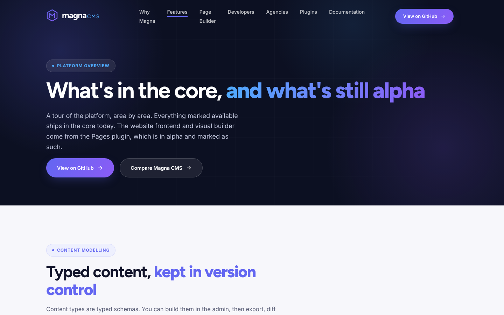
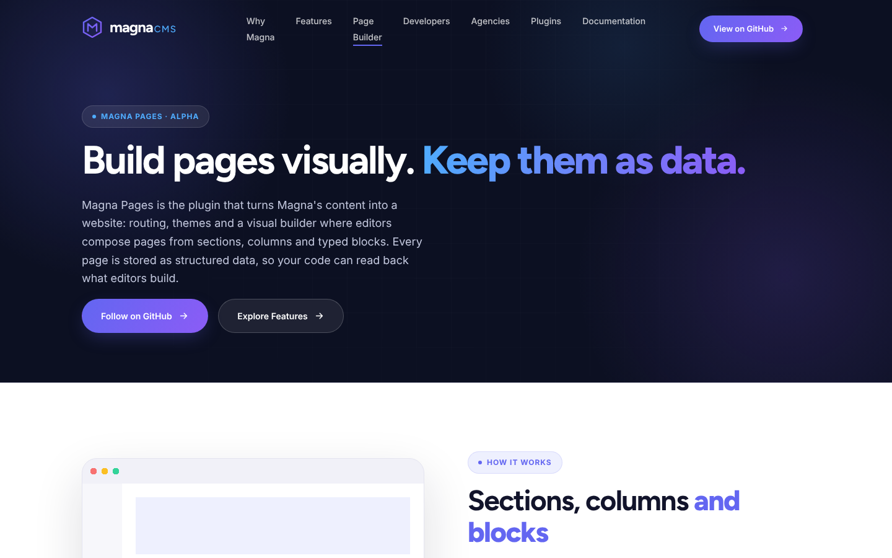
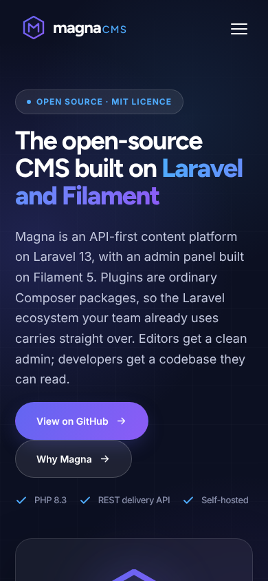
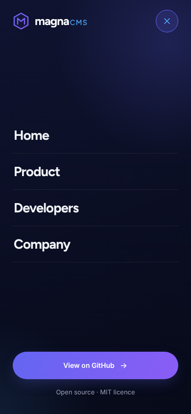
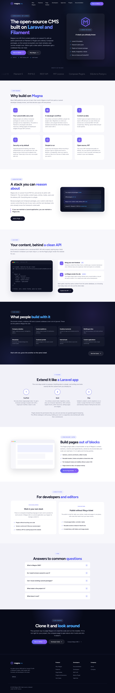

# Kizmath — the Magna CMS website theme

Kizmath is the marketing-site theme for [Magna CMS](https://github.com/Magna-CMS/Magna),
built as a **native Magna theme**: every page, band and block on the site is
real page-builder content an editor can select, edit, reorder and delete. The
theme ships no raw HTML templates, no PHP classes, no asset pipeline and no
served files — one Blade layout carries the whole design, and the content
travels as a site kit.

```
theme.json                      the manifest (kizmath/website)
tokens.json                     design tokens, editable in Appearance → Design
views/system/layout.blade.php   the page shell: all CSS and JS, inline
views/blocks/features.blade.php status pills, tags, sprite icons, bare rows
views/blocks/logo.blade.php     the hexagon mark and wordmark suffix
starter/magna-website.json      the site kit: 11 pages, header/footer parts,
                                5 menus, home and 404 settings — the single
                                source of truth for the site's content
starter/build/kitcheck.py       static checks that prove the kit against the
                                renderer's rules before it is committed
dist/kizmath-website-1.0.0.zip  the ready-to-upload theme package
docs/screenshots/               the pages below, rendered by a real install
docs/strategy/                  the original content-strategy notes (historic;
                                they predate the claims re-audit)
```

## What it looks like

Rendered by Magna core 1.7.2 with Pages 0.7.0-alpha — no mock-ups:

| Home | Features | Page builder |
|---|---|---|
|  |  |  |

| Mobile | Drawer | Full page |
|---|---|---|
|  |  |  |

## Requirements

- Magna core `^1.7`
- The Pages plugin (`magna-cms/pages`) `>= 0.7` — it renders pages, so the
  theme cannot be audited or displayed without it.

The site kit uses **core and Pages blocks only** (heading, text, container,
features, button, table, quote, callout, faq, code, nav, logo), so no other
plugin is required to render any page.

## Install

Either upload **[`dist/kizmath-website-1.0.0.zip`](dist/kizmath-website-1.0.0.zip)**
in **Admin → System → Themes → Upload theme**, or copy `theme.json`,
`tokens.json`, `views/` and `starter/` to `themes/kizmath/website/` inside your
Magna install (the folder must match the manifest name).

Then import the content:

```bash
php artisan magna:site:diff themes/kizmath/website/starter/magna-website.json   # preview
php artisan magna:site:sync themes/kizmath/website/starter/magna-website.json   # apply
```

`magna:site:sync` upserts by slug and never deletes, so re-running it is safe.
Activate the theme from **Admin → System → Themes**, or import the demo
content from the same screen on a fresh install.

Validate the theme against the Pages code audit at any time:

```bash
php artisan magna:theme:check kizmath/website
```

## How the theme is put together

**The layout** (`views/system/layout.blade.php`) renders the chrome — fixed
header, mobile drawer, footer slot, back-to-top — and prints the renderer's
output (`$headerPartHtml`, `$mainHtml`, `$footerPartHtml`, `$popupsHtml`).
All CSS and JS are inline because a theme cannot ship a file that is served.

**The design rides on section CSS classes.** Each section's `cssClass` field
names a band the stylesheet knows: `hero` (and `hero short`), `trust marquee`,
`problem`, `why`, `arch`, `headless`, `cases`, `plugins`, `builder`,
`audiences`, `faq`, `cta`; the row classes carried over from the source grids
(`split`, `hero-grid`, `problem-grid`, `arch-grid`, `headless-grid`,
`builder-grid`); the modifiers `center`, `grid-2`, `prose`, `feat-rows`,
`aud-grid`, `cmp-wrap`, `cases-foot`, `head-continue`, `tail-continue`; and
the chrome classes `header-main`, `drawer-menu`, `footer-main`,
`footer-bottom`. Anything outside this vocabulary renders unstyled —
`starter/build/kitcheck.py` flags it.

**Two block views are overridden.** `features` adds three optional item keys
over core (`status` + `tone` for the avail/dev/plan pills, `tag` for the small
label beside a title), resolves `icon` against the layout's sprite, prints an
unknown icon as text (which is how the numbered plugin steps work), and
renders title-only items as bare list rows — the hero checklists and the
marquee. `logo` draws the hexagon mark from the sprite and splits a
multi-word text ("magna CMS") into the wordmark and its small suffix. Every
other block uses core's view, styled by the layout.

**Menus** are kit data: `primary` in the header part, three `footer_*`
columns in the footer part, and `mobile` inside the header part's hidden
`drawer-menu` section, which the layout's script copies into the drawer.

## Editing content

Edit pages in the builder like any Magna site. The kit's node ids are
deterministic (`kiz-<page>-<kind>-<n>`), so a later `magna:site:sync` updates
the same nodes rather than duplicating them, and theme updates can carry
content changes three-way (entries you edited are kept and reported).

## Updating the kit

The kit is the source of truth; there is no separate authoring format. To
change the site, edit it in the page builder, then export the result back
into the repo when it should ship with the theme:

```bash
php artisan magna:site:export themes/kizmath/website/starter/magna-website.json
python starter/build/kitcheck.py     # proves the kit against the renderer's rules
```

The kit's node ids are deterministic, so an exported kit upserts cleanly on
the next `magna:site:sync` instead of duplicating content.

## Content rules

The copy is audited against the Magna source code. When editing it, keep to
the same rules: no performance numbers (none are published), no plugin
version numbers, Pages is labelled alpha, and the stack is named concretely —
Laravel 13, Filament 5, PHP 8.3. If a sentence states a capability, it should
be one you can point to in the code.

## Licence

MIT, like Magna itself.
